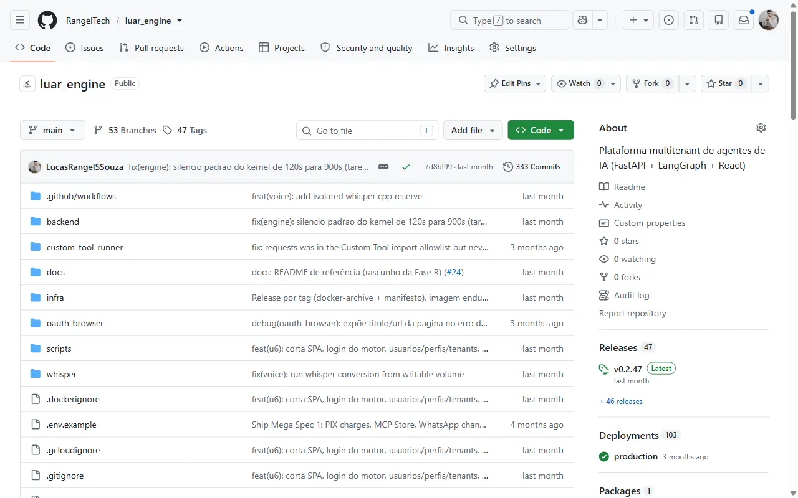

<!-- readme-padrao -->
# LUAR: motor de IA

> Motor de IA do LUAR (agentes, templates, ferramentas) e o serviço de transcrição Whisper.



## O que é
Motor de IA do LUAR (agentes, templates, ferramentas) e o serviço de transcrição Whisper.

Estado: **no ar (LUAR em preparo)**.

## Onde está no ar
- Sem endereço público próprio.

## Onde faz o deploy
Este repositório **só publica** o artefato (release com imagem e manifesto); **quem implanta é o `vps_rt_infra`**.

- Serviço `agent-platform-backend`: `gh workflow run deploy.yml --repo RangelTech/vps_rt_infra -f service=agent-platform-backend` (só validar: `-f dry_run=true`; voltar versão: `-f version=<tag-antiga>`)
- Serviço `whisper-cpp`: `gh workflow run deploy.yml --repo RangelTech/vps_rt_infra -f service=whisper-cpp` (só validar: `-f dry_run=true`; voltar versão: `-f version=<tag-antiga>`)

Os `.env` desses serviços são gerados do Infisical no momento do deploy (spec 57, seção 0A).

## Como funciona por dentro
Resumo acima; os detalhes estão nas notas técnicas (README anterior) abaixo e na spec 57.

## Segredos
Nenhum valor de segredo fica neste repositório. Os segredos dos serviços ficam no Infisical (mapa em `vps_rt_infra/scripts/infisical/mapa_envs.json`) e chegam à VPS gerados no deploy.

## Rodar e testar localmente
Ver as notas técnicas abaixo (cada repositório tem o seu jeito); os testes de QA em produção são por cliques reais, com evidência em `new_ragente/qa/evidencias`.

## Links
- Repositório: https://github.com/RangelTech/luar_engine
- Painel único: https://painel.rangeltech.net
- Spec de organização geral: `new_ragente/specs/57_ORGANIZACAO_GERAL_PRODUTOS_E_PAINEL.md`

## Notas técnicas (README anterior)

# luar_engine

O motor de IA do Luar. É um backend FastAPI, sem tela e sem login próprio, que guarda e executa o que faz um agente funcionar: templates e versões, skills, credenciais, datasources, memórias, uso e rotinas agendadas.

> Nome anterior: `agent-platform`. A pasta `frontend/` (React) saiu no corte U-6 (22/10/2026); as telas ficam no `luar_chatwoot`.

## Onde ele se encaixa

```
                    Cliente (navegador e canais)
                                |
                        Traefik (VPS)
                                |
 luar_chatwoot --contexto assinado--> luar_engine --runs--> luar_harness
 (telas, inbox, Kanban,               (motor de IA:         (fila, broker,
  bridge, gateway de canais)           templates, skills,    workers Hermes)
                                       credenciais, uso)            |
                                            |                luar_workspaces
                                       luar_ai_gateway       (ambiente de cada
                                       (LLM multi-tenant)     empresa)

 vps_rt_infra: compose, releases por digest, deploy e backup (só ela implanta)
 airflow:      orquestração da empresa, inclui o backup noturno da VPS
 luar_docs:    specs, evidências e ADRs
```

Recebe chamadas do `luar_chatwoot` com contexto assinado, monta a run e a entrega ao `luar_harness`. Os modelos são chamados pelo `luar_ai_gateway`.

## Árvore de pastas

```
backend/app/         código do motor (rotas, kernel_router, harness_runtime, scheduler, uso)
backend/migrations/  migrations SQL, aplicadas quando o serviço sobe
backend/tests/       testes pytest (caixa preta na API, modelo de IA simulado)
custom_tool_runner/  execução isolada de ferramentas personalizadas
scripts/             provisionamento e manutenção (provisionar_router, graph_desligar, importar_oauth, verify.sh)
docs/                arquitetura, contratos e runbooks
```

## Como rodar

```bash
cd backend
py -3.12 -m venv .venv && .venv/Scripts/pip install -r requirements.txt
docker compose up postgres        # pgvector/pg16, só para desenvolvimento
.venv/Scripts/uvicorn app.main:app --port 8090
```

## Como testar

`cd backend && pytest -q` roda offline. Testes marcados `integration` pedem Postgres. O gate completo é `scripts/verify.sh`.

## Como implantar

Uma tag `v*` gera `image.tar.gz` e `release-manifest.json`. O deploy é só pelo `vps_rt_infra`. Em produção o serviço continua chamando `agent-platform-backend`.

## Variáveis de ambiente

Definidas em `backend/app/config.py` (aqui só os nomes): `DATABASE_URL`, `KERNEL_HARNESS_URL`, `KERNEL_HARNESS_AUDIENCE`, `KERNEL_HARNESS_TOKEN`, `HARNESS_INTERNAL_TOKEN`, `RUN_TOKEN_SECRET`, `UI_CONTEXT_SECRET`, `ENCRYPTION_KEY`, `SCHEDULER_ENABLED`. Segredos de negócio ficam cifrados no banco.

## Isolamento e segurança

- Toda consulta é filtrada por empresa (`tenant_id`).
- As rotas `/internal/*` só aceitam o token de serviço ou o `run_token` da própria run.
- Segredos nunca voltam em resposta, log ou evento.

## Contratos e APIs

| Superfície | Quem chama | Como autentica |
|---|---|---|
| `/api/*` (templates, skills, credenciais, datasources, memórias, uso, ambiente, aprovações, Hermes) | BFF do `luar_chatwoot` | contexto assinado (`UI_CONTEXT_SECRET`), nunca login |
| `/internal/*` e `/internal/ui/*` | `luar_harness` e BFF | token de serviço ou `run_token` da própria run |
| `/v1/messages` | integrações de máquina | chave de integração da empresa |

O contrato do harness está em [`backend/docs/harness-internal-api.md`](backend/docs/harness-internal-api.md). O roteamento de IA por empresa está em [`docs/router-ia-por-tenant.md`](docs/router-ia-por-tenant.md).

## Runbooks e decisões

- [`docs/runbooks/desligar-graph.md`](docs/runbooks/desligar-graph.md): desligar os agentes `graph` de uma empresa, com backup e reativação.
- [`docs/adr/0001-motor-sem-login.md`](docs/adr/0001-motor-sem-login.md): por que o motor não autentica pessoas.
- Specs, evidências e decisões globais: repositório `luar_docs`.

## Em extinção

Os agentes `graph` e o `kernel-llm` saem na Fase L. Os dados ficam preservados.

## Como contribuir

Uma branch por tarefa, Conventional Commits em português, testes verdes e PR. Código e identificadores em inglês; textos de interface em português.
